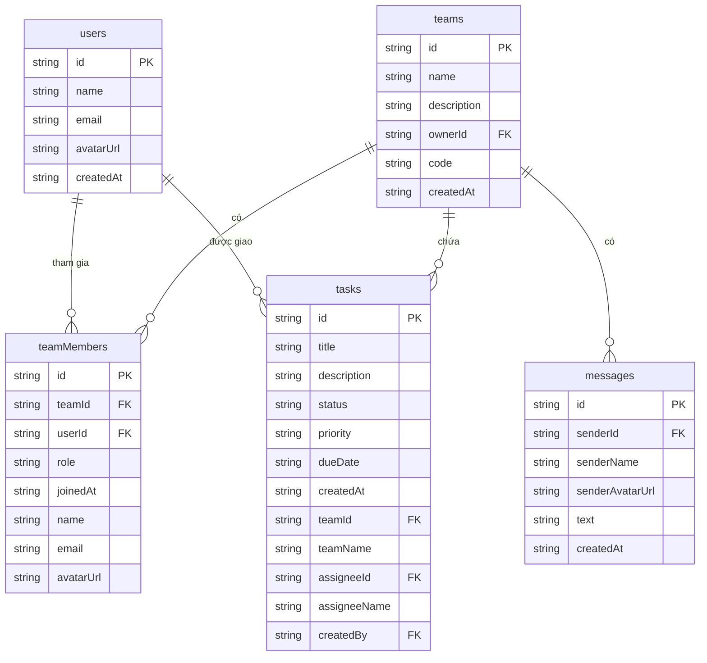

# TaskFlow Manager — Practical Exam 2

React Native (Expo SDK 57) + TypeScript + Firebase. Đây là bản mở rộng của **Practical Exam 1**
(bài CRUD công việc với Firestore), bổ sung **Firebase Authentication**, chức năng **Teams thật**,
**giao việc cho thành viên nhóm** và **chat real-time theo nhóm**.

---

## 1. Tính năng đã hoàn thành

### 1.1. Firebase Authentication
- Đăng ký (Sign Up): họ tên, email, mật khẩu → tạo tài khoản Firebase Auth + document `users/{uid}`.
- Đăng nhập (Login): email / mật khẩu, có thông báo lỗi tiếng Việt (sai mật khẩu, email đã tồn tại, ...).
- Đăng xuất (Logout) từ màn hình Hồ sơ.
- **Duy trì phiên đăng nhập** qua `onAuthStateChanged` + `AsyncStorage` (React Native) nên mở lại app không phải đăng nhập lại.
- **Bảo vệ màn hình**: `RootNavigator` chỉ hiển thị Home / Teams / Chat khi đã đăng nhập; ngược lại hiển thị luồng Login/SignUp.

### 1.2. Teams (thay thế placeholder của Assignment 1)
- Tạo nhóm mới (tên, mô tả) — người tạo tự động trở thành **Trưởng nhóm (leader)**.
- Tham gia nhóm bằng **mã nhóm** 6 ký tự.
- Collection `teams` và `teamMembers` (xem mô hình dữ liệu bên dưới).
- Màn hình **Team Detail**: thông tin nhóm, danh sách thành viên (tên/email/vai trò) và danh sách công việc của nhóm.

### 1.3. Công việc gắn với nhóm và người được giao
- Form tạo/sửa công việc cho phép chọn **nhóm** (`teamId`) và **người được giao việc** (`assigneeId`) từ danh sách thành viên.
- Thẻ công việc hiển thị tên nhóm và tên người được giao.
- Home chỉ hiển thị công việc thuộc các nhóm mà người dùng tham gia.

### 1.4. Chat real-time theo nhóm
- Một phòng chat cho mỗi nhóm: `teams/{teamId}/messages`.
- Sắp xếp theo `createdAt`, hiển thị tên người gửi + nội dung + thời gian.
- Tin nhắn của chính người dùng được căn phải/màu xanh, của người khác căn trái/màu trắng.
- Dùng `onSnapshot` nên tin nhắn mới xuất hiện **tự động**, không cần refresh.
- Có ô nhập và nút Gửi.

### 1.5. Firestore Security Rules
- Mọi thao tác đọc/ghi đều yêu cầu `request.auth != null`.
- Tin nhắn chỉ cho thành viên nhóm; nhóm chỉ chủ sở hữu được sửa/xóa; người dùng chỉ sửa hồ sơ của chính mình.

### 1.6. Tính năng bonus
- Chọn/upload **ảnh đại diện** (Firebase Storage) hiển thị ở màn hình Hồ sơ.
- **ERD / mô hình dữ liệu** trong README này.

---

## 2. Công nghệ sử dụng
| Thành phần | Công nghệ |
|---|---|
| Frontend | React Native, Expo SDK 57, TypeScript |
| Navigation | React Navigation (native-stack + bottom-tabs), auth-aware |
| State | React Context (`AuthContext`) cho trạng thái đăng nhập |
| Backend | Firebase Authentication, Cloud Firestore, Firebase Storage |
| Version control | Git & GitHub |

---

## 3. Cài đặt & chạy

```bash
npm install
cp .env.example .env   # điền thông tin Firebase của bạn
npm start              # mở Expo, quét QR bằng Expo Go
# hoặc
npm run android
npm run web
```

### Biến môi trường (`.env`)
```
EXPO_PUBLIC_FIREBASE_API_KEY=...
EXPO_PUBLIC_FIREBASE_AUTH_DOMAIN=...
EXPO_PUBLIC_FIREBASE_PROJECT_ID=...
EXPO_PUBLIC_FIREBASE_STORAGE_BUCKET=...
EXPO_PUBLIC_FIREBASE_MESSAGING_SENDER_ID=...
EXPO_PUBLIC_FIREBASE_APP_ID=...
```

### Triển khai Security Rules
```bash
firebase deploy --only firestore:rules
firebase deploy --only storage
```

Trong **Firebase Console → Authentication → Sign-in method**, bật **Email/Password**.

---

## 4. Mô hình dữ liệu (ERD / Schema)



### Cấu trúc collection trong Firestore
```
users/{userId}
    { id, name, email, avatarUrl, createdAt }

teams/{teamId}
    { id, name, description, ownerId, code, createdAt }

teams/{teamId}/messages/{messageId}
    { id, senderId, senderName, senderAvatarUrl, text, createdAt }

teamMembers/{teamId_userId}
    { id, teamId, userId, role, joinedAt, name, email, avatarUrl }

tasks/{taskId}
    { id, title, description, status, priority, dueDate, createdAt,
      teamId, teamName, assigneeId, assigneeName, createdBy }
```

---

## 5. Cấu trúc mã nguồn
```
src/
├── components/     TaskCard, TaskModal
├── contexts/       AuthContext (state đăng nhập toàn cục)
├── hooks/          useTasks, useTeams, useTeamDetail, useMessages
├── navigation/     RootNavigator (auth-aware), AuthNavigator, AppNavigator,
│                   BottomTabNavigator, types
├── screens/        LoginScreen, SignUpScreen, HomeScreen, TeamsScreen,
│                   TeamDetailScreen, ChatScreen, ProfileScreen
├── services/       firebase, authService, teamService, messageService, taskService
└── types/          user, team, message, task
```

## 6. Luồng điều hướng
```
RootNavigator
├── [chưa đăng nhập] AuthNavigator : Login → SignUp
└── [đã đăng nhập]   AppNavigator
        ├── Tabs (BottomTabNavigator): Home | Teams | Profile
        ├── TeamDetail  (từ Teams)
        └── Chat        (từ TeamDetail)
```

## 7. Tài khoản kiểm thử
Tạo tối thiểu 2 tài khoản để minh hoạ chat & giao việc, ví dụ:
- `an@example.com` / `123456`
- `binh@example.com` / `123456`

> Ảnh chụp minh chứng (Auth console, Firestore console, Rules, các màn hình, chat giữa 2 người dùng)
> được trình bày trong tài liệu báo cáo `StudentID_Exam2.docx` kèm theo.
